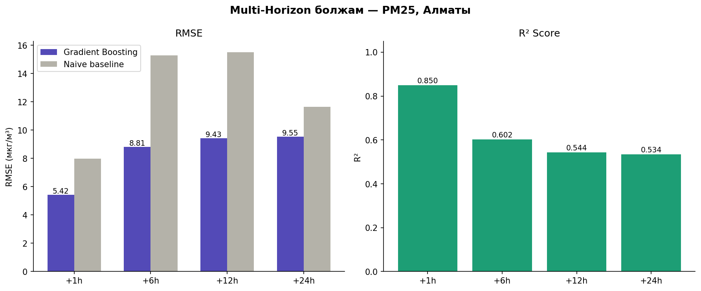

# Almaty Air Quality Forecasting

A Python research project comparing statistical and machine learning models for PM2.5 and PM10 forecasting in Almaty, Kazakhstan.

The v2 workflow combines pollution history, weather variables and calendar features to predict concentrations at **1, 6, 12 and 24 hours**. It includes model comparisons, feature-group ablations and optional SHAP explanations.

## Saved experimental results

The table below summarizes the committed [v2 metrics](reports/metrics_v2.csv). Each row shows the lowest-RMSE trained model among Ridge, Random Forest and Gradient Boosting for that pollutant and horizon.

These are **saved exploratory results**, not a fresh reproduction or a validated operational forecast. Evaluation limitations are described below. RMSE and MAE are in µg/m³; lower is better.

| Pollutant | Horizon | Model | RMSE | MAE | R² | Lag-1 baseline RMSE |
| --- | --- | --- | ---: | ---: | ---: | ---: |
| PM2.5 | 1 h | Gradient Boosting | 5.417 | 3.607 | 0.850 | 7.974 |
| PM2.5 | 6 h | Gradient Boosting | 8.810 | 6.138 | 0.602 | 15.299 |
| PM2.5 | 12 h | Ridge | 9.124 | 6.361 | 0.574 | 15.514 |
| PM2.5 | 24 h | Ridge | 9.190 | 6.412 | 0.568 | 11.637 |
| PM10 | 1 h | Gradient Boosting | 5.871 | 4.007 | 0.843 | 8.384 |
| PM10 | 6 h | Gradient Boosting | 10.290 | 7.588 | 0.516 | 16.117 |
| PM10 | 12 h | Random Forest | 11.435 | 8.508 | 0.403 | 16.529 |
| PM10 | 24 h | Random Forest | 11.879 | 8.948 | 0.356 | 13.634 |

In this saved comparison, Gradient Boosting has the lowest RMSE at 1 and 6 hours for both pollutants. At longer horizons, Ridge or Random Forest performs better. Selecting the best row on this test set is descriptive; it does not provide an independent estimate after model selection.



The chart compares Gradient Boosting with the implemented lag-1 baseline; it does not show the best model at every horizon.

## Data and features

The v2 acquisition script requests hourly data for **2024-01-01 through 2025-12-31**, at **43.25°N, 76.95°E**, using the `Asia/Almaty` timezone.

- **Air quality:** [Open-Meteo Air Quality API](https://open-meteo.com/en/docs/air-quality-api); PM2.5, PM10 and additional pollutant variables.
- **Weather:** [Open-Meteo Historical Weather API](https://open-meteo.com/en/docs/historical-weather-api); temperature, humidity, wind and other weather variables.
- **Optional station weather:** Meteostat integration. The committed ablation tables show no added features in the Meteostat step, so they do not demonstrate a station-data contribution.

The API-derived pollution series is not established here as a local monitoring-station measurement dataset. The weather request does not explicitly select a model, so its outputs should not be assumed to be exclusively ERA5.

Features include pollutant lags (1–168 hours), shifted rolling statistics, changes in concentration, cyclic calendar encodings and weather-derived variables. Separate targets are created with `shift(-h)` for each horizon.

## Method

The v2 modeling script:

1. Uses the first 80% of rows for training and the remaining 20% for testing, in file order.
2. Fits a median imputer on training features and applies it to test features.
3. Compares Ridge, Random Forest and Gradient Boosting against a lag-1 baseline.
4. Exports RMSE, MAE, R² and MAPE, plus ablation charts and optional SHAP plots.

MAPE is computed only where the target exceeds 1 µg/m³. The v2 script uses a single holdout split; importing `TimeSeriesSplit` does not implement cross-validation.

## Run the v2 workflow

Use Python 3.10 or later and run commands from the repository root. Dependencies below cover the v2 modeling path; versions are not pinned.

```bash
git clone https://github.com/assem-a7/almaty_air_research.git
cd almaty_air_research
python -m venv .venv
```

Activate the environment:

- Windows PowerShell: `.\.venv\Scripts\Activate.ps1`
- macOS / Linux: `source .venv/bin/activate`

Install dependencies and run with the **committed feature CSVs**:

```bash
python -m pip install pandas numpy scipy scikit-learn matplotlib
python src/modeling_v2.py
```

The script trains models for both pollutants and all four horizons. It overwrites `reports/metrics_v2.csv`, the ablation CSVs and corresponding figures. Runtime depends on the machine.

SHAP is optional; install it before running if explanations are needed:

```bash
python -m pip install shap
```

To attempt a fresh data download and feature rebuild:

```bash
python -m pip install requests
python src/data_v2_openmeteo.py
```

This requires internet access and compatible upstream APIs. Meteostat is optional and is skipped if unavailable; its integration uses the `Stations` / `Hourly` API. A fresh download has not been verified as part of this documentation update and may differ from the committed data. The v2 scripts use their own constants rather than `src/config.py`.

## Repository guide

| Path | Purpose |
| --- | --- |
| [src/data_v2_openmeteo.py](src/data_v2_openmeteo.py) | Data acquisition, joins and feature engineering |
| [src/modeling_v2.py](src/modeling_v2.py) | Multi-horizon modeling, metrics, ablation and SHAP |
| [data/](data/) | Committed v2 raw and feature CSVs |
| [reports/metrics_v2.csv](reports/metrics_v2.csv) | Saved metrics for all models and horizons |
| [reports/ablation_pm25.csv](reports/ablation_pm25.csv) | PM2.5 feature-group comparison |
| [reports/ablation_pm10.csv](reports/ablation_pm10.csv) | PM10 feature-group comparison |
| [reports/figures/](reports/figures/) | Saved v1 and v2 visualizations |
| [src/notebooks/](src/notebooks/) | Supporting notebooks |
| [src/modeling_forecast_pm25_t1.py](src/modeling_forecast_pm25_t1.py), [src/modeling_forecast_pm10_t1.py](src/modeling_forecast_pm10_t1.py) | Earlier one-hour workflow; expects `data/raw/pollution.csv` |

Earlier scripts and their figures are retained for reference. Their outputs should not be mixed with the v2 metrics.

## Evaluation limitations and next steps

- **Split boundary:** v2 does not purge training rows whose future target timestamps overlap the test period. Horizon-aware gaps and rolling-origin validation are needed.
- **Forecast timing:** the baseline uses `PM(t-1)` to predict `PM(t+h)`. Most features are shifted, but wind components use weather at row time `t`. A consistent forecast issue time and input-availability policy should be defined before comparing operational skill.
- **Chronology and availability:** v2 trusts CSV row order and does not enforce regular hourly timestamps. Historical weather availability at forecast issue time is not verified.
- **Statistical evidence:** the helper labeled as a Diebold–Mariano test uses a simple variance estimate without serial-correlation correction. It is not used here to claim statistical significance.

Next steps are to address these evaluation issues, rerun the comparisons and pin a reproducible environment. This repository currently demonstrates an offline research workflow.

## Author

Assem Abdikarim · Eurasian National University

**Tools:** Python, pandas, NumPy, scikit-learn, SciPy, Matplotlib; optional SHAP.

